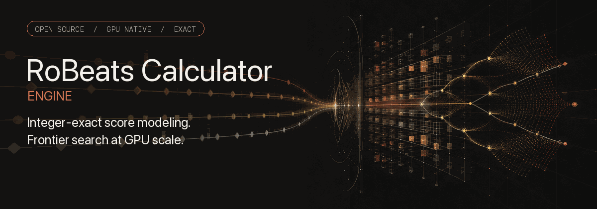
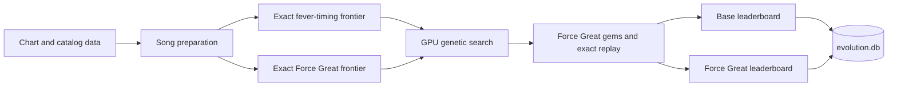

<div align="center">



# RoBeats Calculator Engine

**Finds the highest-scoring gear, Mini, gem and fever-timing build for any RoBeats chart.**

[](https://www.python.org/downloads/)
[](LICENSE)
[](https://numba.pydata.org/)
[](https://www.taichi-lang.org/)
[](https://robeatsmeta.net)

[RoBeatsMeta](https://robeatsmeta.net) · [Quick start](#quick-start) · [How it works](#how-it-works) · [Repository layout](#repository-layout) · [Documentation](docs/README.md)

</div>

> [!NOTE]
> An independent community project, not affiliated with or endorsed by RoBeats, Roblox, or any game publisher.

## What it does

Given a chart, the engine searches six gear slots, three Mini slots, gems, fever timing and Force Great plays, scores
each candidate with the game's integer arithmetic, and keeps the best builds on two leaderboards: Base and Force Great.
It runs from the command line over a queue of charts or as an HTTP service, and it is the solver behind
[RoBeatsMeta](https://robeatsmeta.net).

| Stage | Method | Guarantee |
|---|---|---|
| Gear and Mini search | Multi-start genetic search on the GPU (Taichi on Vulkan) | Heuristic: bounded by its search budget, no optimality proof |
| Fever timing | Non-dominated frontier of the reachable timelines | Exact |
| Force Greats | Frontier of reachable response surfaces under lane, chart-order and timing limits | Exact |
| Gems | Bounded search over the frontier surfaces a loadout reaches | Exact for that loadout |
| Scoring | Per-note integer floors, combo order, fever membership, Great penalties | Exact |

**Limits:** the search covers Perfect and Great plays; deliberate Okay, Miss and combo-break strategies are out of
scope. Frontiers use the base hit windows. A build's Perfect Time stat moves its windows: its note plans follow them,
while its scores can under-report what the wider windows reach.

## Quick start

You need Python 3.11 or newer, a Vulkan-capable GPU with current drivers, and disk space for frontier caches. The GPU
is required for the search; CPU implementations exist for reference and verification.

```bash
git clone https://github.com/TheBaconactor/RoBeats-Calculator-Engine.git
cd RoBeats-Calculator-Engine
python3 -m venv .venv
source .venv/bin/activate    # Windows PowerShell: .\.venv\Scripts\Activate.ps1
python -m pip install -r requirements.txt
```

Choose charts in `config.ini` (the repository ships the catalog under [`Data/`](Data/README.md)):

```ini
[CalculateSong]
Song_Name = Surf
Difficulty = Hard
```

Then run the optimizer:

```bash
python main.py
```

The first run compiles the Numba and Taichi kernels and builds any missing frontiers; later runs reuse them from
`bin/`. Results go to `evolution.db`, or to the path in `EVOLUTION_DB_PATH`. Press `Ctrl+C` once to stop gracefully and
twice to force an exit, or create `bin/STOP`.

<details>
<summary><strong>Every <code>config.ini</code> key</strong></summary>

`config.ini` accepts exactly these keys; an unknown or removed key stops the run with an error that names it.

| Section | Key | Default | Meaning |
|---|---|---|---|
| `[CalculateSong]` | `Song_Name` | empty (every chart) | Solve charts whose name contains this text |
| | `Difficulty` | `All` | `Easy`, `Normal`, `Hard` or `All` |
| | `TargetPrimary`, `TargetSecondary` | `All` | Colors to include, e.g. `Rush` or `Flow,Beat` |
| | `LoopForever` | `false` | Rescan and solve the queue again when it finishes |
| `[IterationEngine]` | `SongRepeats` | `1` | Runs per solve (a chart in one timing mode), each with its own search seed |
| | `SongQueueLimit` | `0` (no limit) | Solve runs per pass: the queue takes the solves the database lacks first, then the least recently solved |
| | `GA_SearchDepth` | `210` | Search generations over all populations (42 each by default) |
| | `GA_MultiStart` | `5` | Independent search populations |
| | `Workers` | `0` (by machine) | Solve processes; `0` picks one per logical performance core on a Windows hybrid CPU (the first three quarters on the P-cores, the rest on the E-cores), else a quarter of the logical cores |
| | `MemorySoftLimitGB` | `0` (off) | The run's memory limit: a worker past its share (the limit / `Workers`) is replaced after its song |
| | `MemorySoftLimitPercent` | platform default | The same limit as a share of physical memory (`0` disables) |

</details>

### Commands

```bash
python main.py                                 # Run the optimizer over the config.ini queue
python -m gear_optimizer.robeatsmeta_service --host 127.0.0.1 --port 8765   # HTTP service
python -m gear_optimizer.reverse --song "Surf (Hard) by Hyper Potions" --score 30590191 --accuracy 100 --casual 1234567 --gear-power 4321   # The set behind a Top Scores row
python -m tools list                           # List the developer tools
```

| Endpoint | Purpose |
|---|---|
| `GET /songs` | Official chart metadata |
| `POST /optimize` | Optimize an official chart or supplied chart text |
| `POST /frontiers/refresh` | Re-read the chart list and look for a new revision |

Bind the service to loopback unless it sits behind a trusted boundary, and set `ROBEATSMETA_OPTIMIZER_API_TOKEN` before
exposing it to a network. Every environment variable the engine reads is documented in
[`gear_optimizer/settings.py`](gear_optimizer/settings.py).

## How it works



1. **Prepare.** Read the chart, gear, Mini and stat data, and materialize song-specific state such as Mini Ascension.
2. **Frontiers.** Load or build the fever-timing and Force Great frontiers: every non-dominated way to play the chart,
   cached per chart and rebuilt only when the logic that produced them changes.
3. **Search.** The genetic search runs on one GPU thread; its loadouts read the frontiers to score whole builds, each
   with its best gems and its exact score.
4. **Finish.** An exact CPU search places the loadouts' Force Great gems, an exact replay confirms every score, and the
   winners go to the Base and Force Great leaderboards. A stored build keeps the replay witness that proves it is
   playable, which later turns into a note-by-note plan.

[`docs/ARCHITECTURE.md`](docs/ARCHITECTURE.md) has the full flow, and [`docs/math/`](docs/math/) has the mathematics.

## Repository layout

```text
RoBeats-Calculator-Engine/
├── main.py                   # Optimizer entry point
├── config.ini                # Chart and queue selection
├── gear_optimizer/
│   ├── pipeline/             # A solve end to end: queue, preparation, search, Force Greats, storing
│   ├── solver/               # Search and exact scoring: GA pipeline, gem search, timing envelope, score tables
│   ├── frontier/             # Exact timing and Force Great frontiers and their caches (CPU, Numba)
│   ├── gpu/                  # Everything Taichi: fields, kernels, the genetic search and the GPU's owner thread
│   ├── reverse/              # Score reverse-lookup: from a shown score to the set behind it, or why there is none
│   ├── trace/                # Stored builds to playable note plans, and their physical replay checks
│   ├── store/                # The results database: schema, boards, reads and writes
│   ├── core/, data/, domain/, ui/   # Shared utilities, the game export, job and board rules, progress output
│   ├── app.py, cli.py        # Run lifecycle and command line
│   ├── robeatsmeta_service.py, service_worker.py, service_update.py   # HTTP service, its solve process and self-update
├── general_meta/             # Cross-song General Meta analysis
├── tools/                    # Verification gates, game oracles and maintenance utilities
├── tests/                    # CPU, GPU, parity and regression coverage
├── docs/                     # Architecture, mathematics and research
├── Data/                     # Charts and the game export
└── .github/                  # Contributing, governance, security, support and templates
```

Runtime databases, caches, logs and credentials stay out of version control.
[`docs/NAVIGATION.md`](docs/NAVIGATION.md) maps each behavior to the file that owns it.

## Development

```bash
python -m pip install -r requirements-dev.txt
python -m ruff check .
python -m pytest -m "not gpu" tests/
python -m pytest -m gpu tests/    # GPU, timing, cache or reachability changes
```

Tests guard behavior, but they are not ground truth: a wrong rule can be written into a test and then confirmed by it.
Changes to scoring and timing are proved against independent references:

| Tool | What it proves |
|---|---|
| [`tools/verify/gate.py`](tools/verify/gate.py) | A fixed chart set through every output: a lossless change must match a base tree byte for byte, with each solve stage priced side by side |
| [`tools/verify/game_sim.py`](tools/verify/game_sim.py) | A frame-by-frame simulation of input matching, fever and score |
| [`tools/verify/frame_play.py`](tools/verify/frame_play.py) | A simulated player through a port of the game's frame loop and server replay |
| [`tools/verify/score_reverse_benchmark.py`](tools/verify/score_reverse_benchmark.py) | Seeded dev/held-out benchmark of the score reverse-lookup on fake players, whose Play Info is its input |
| [`tools/verify/fake_players.py`](tools/verify/fake_players.py) | Fake players: a real set, realistic hands, and the Top Scores row of their best play |
| [`tools/verify/verify_fg_game_oracle.py`](tools/verify/verify_fg_game_oracle.py) | Stored Force Great winners rescored by a port of the game's score path |
| [`tools/verify/reference_oracle/`](tools/verify/reference_oracle/README.md) | Note traces replayed through the reference score engine |

See the [contribution guide](.github/CONTRIBUTING.md) before opening a pull request.

## Documentation

| Topic | Where |
|---|---|
| All documentation | [`docs/README.md`](docs/README.md) |
| System design and file map | [`docs/ARCHITECTURE.md`](docs/ARCHITECTURE.md), [`docs/NAVIGATION.md`](docs/NAVIGATION.md) |
| Formulas and exact timing | [`docs/math/`](docs/math/) |
| Results database | [`docs/DATABASE_SCHEMA.md`](docs/DATABASE_SCHEMA.md) |
| Data layout and deployment | [`Data/README.md`](Data/README.md), [`docs/MAINTENANCE_PLAYBOOK.md`](docs/MAINTENANCE_PLAYBOOK.md) |
| Help and troubleshooting | [`.github/SUPPORT.md`](.github/SUPPORT.md) |
| Governance and maintainers | [`.github/GOVERNANCE.md`](.github/GOVERNANCE.md) |
| Security reports | [`.github/SECURITY.md`](.github/SECURITY.md) |

## License

Licensed under the [Apache License 2.0](LICENSE).
