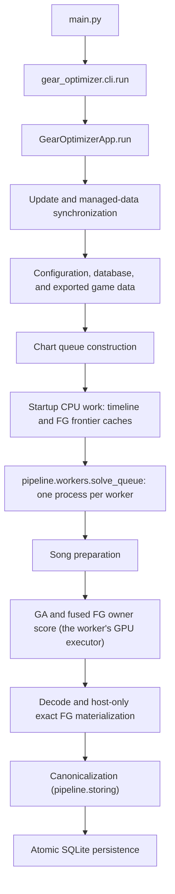
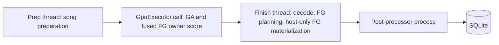
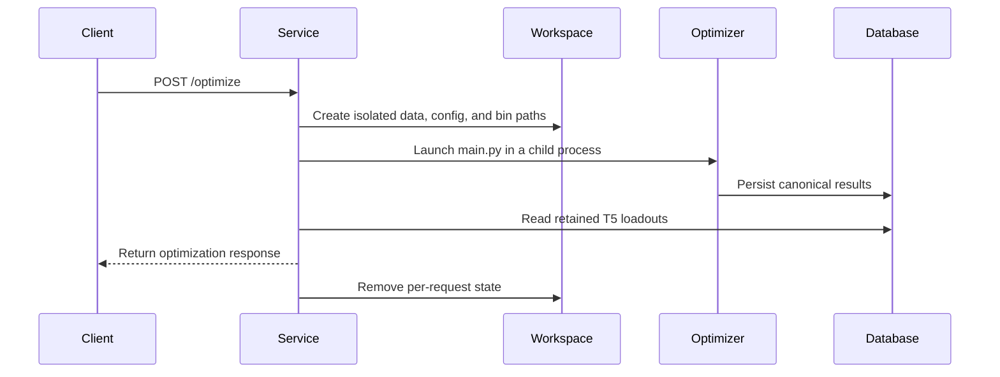

# Architecture

RoBeats Calculator Engine is a GPU-first optimization system with explicit
ownership boundaries for search, exact scoring, Force Great planning, and
persistence. This page follows the current production code. For a file-oriented
index, see [NAVIGATION.md](NAVIGATION.md).

## Runtime surfaces

The repository has two supported runtime surfaces:

- the command-line optimizer, which runs a selected chart queue; and
- the HTTP service, which isolates each optimization request and launches the
  command-line optimizer in a child process.

The outer genetic search is heuristic and budget-bounded. Exactness claims apply
to evaluation of supported score and timing surfaces and to canonical rescore,
not to exhaustive enumeration of every possible loadout.

## Command-line optimizer

`GearOptimizerApp._run_single_iteration()` owns startup ordering:

1. synchronize the client and optional managed frontier data;
2. load configuration and resolve paths;
3. initialize SQLite and synchronize exported game data;
4. load stats, gear, minis, and the selected chart queue;
5. build or verify timeline and Force Great response-frontier caches; and
6. solve the queue of `domain.jobs.SongTask`s (one per song run) with `pipeline.workers.solve_queue`.

The parent process runs no GPU work: each worker owns its Taichi/Vulkan runtime
(a GPU executor thread, initialized on the worker's main thread on macOS).

## Execution and ownership

`gear_optimizer/pipeline/workers.py` solves the queue on `Workers` processes
(config.ini). Each worker takes the next task from a shared queue, solves it
(`pipeline/solve.py`: preparation, the GA and FG turn on its GPU executor, the
host-only finish) and stores it (`pipeline/storing.py`), the path the
service's persistent worker takes for one request. Workers report on a pipe of
their own; the parent counts progress, replaces a worker that left for memory
or died in a song (that song fails), and stops them all on a stop request or a
lost GPU. GA seeds are per song, mode and run, so results do not depend on the
number of workers or on which worker took a song.

The main execution owners are:

- `gear_optimizer/pipeline/workers.py` for the queue on the run's worker
  processes;
- `gear_optimizer/pipeline/solve.py` for a song's stages;
- `gear_optimizer/pipeline/song.py` for the state of a song being solved and
  `pipeline/prepare.py` for its preparation;
- `gear_optimizer/gpu/ga.py` for the GA on the GPU and `gear_optimizer/solver/ga_selection.py` for the loadouts it hands on;
- `gear_optimizer/pipeline/fg.py` for Force Great preparation, planning and
  results;
- `gear_optimizer/pipeline/storing.py` for storing a solved song;
- `gear_optimizer/gpu/executor.py` for all GPU execution: in each
  worker one owner thread initializes Taichi and runs every GPU call.

Force Great payload materialization is CPU-only and runs on the worker's main
thread; it never initializes or accesses the GPU.

## Search, scoring, and Force Great frontiers

### Genetic search

- `gear_optimizer/solver/genetic_pipeline.py` constructs native GA requests; the
  FG stage (`gear_optimizer/pipeline/fg.py`) reads the selected payload it returns.
- `gear_optimizer/gpu/ga.py` runs a song's GA; `gear_optimizer/gpu/device.py` holds a process's GPU state and a song's uploads.
- `gear_optimizer/gpu/fields.py` declares the device fields; `gear_optimizer/gpu/kernels.py` and `gear_optimizer/gpu/scoring.py` run on them.

Only `gear_optimizer/gpu/` imports Taichi; the rest of the engine submits work to
its executor.

### Exact score and timing authority

- `gear_optimizer/solver/scoring/` owns integer score evaluation and canonical
  rescore.
- `gear_optimizer/solver/fever_timeline.py` owns Fever timeline semantics.
- `gear_optimizer/frontier/timeline_producer.py` constructs exact,
  non-dominated timing surfaces.
- `gear_optimizer/solver/timing_envelope.py` applies the selected timing model:
  `non-precise` (the default: Perfects at chart time, early Greats only to order tied notes) or `precise`
  (hits anywhere inside their judgment windows, event-time fever). Official Non-Precise service solves populate
  the canonical catalog; Precise solves stay isolated. Changing an existing Precise catalog requires rebuilding
  it from Non-Precise solves: the database does not store timing mode, and best-score merging cannot replace higher
  Precise scores with their Non-Precise counterparts. Hit guidance describes the selected mode's judgment and fever
  boundaries; neither mode promises the retired Frame-Safe guarantee at every frame timing.

CPU exact scoring is a production canonicalization boundary as well as a parity
oracle. It is not a silent recovery path for failed GPU execution.

### Force Great ownership

Force Great behavior is split by responsibility:

- `gear_optimizer/frontier/` owns the exact numba producer (Base and Force Great) and the disk caches of its output,
  including the startup prebuild; nothing there loads Taichi;
- `gear_optimizer/solver/fg_scoring.py` owns the exact gem search over a song's scoring bundle;
- `gear_optimizer/trace/` owns a surface's play: trace reconstruction, activation witnesses, the note graph, physical
  replay and the persisted FG payload; and
- `gear_optimizer/solver/scoring/` owns canonical exact rescore of retained
  Force Great results.

Response-frontier identity includes the chart and score semantics that can
change a result. A missing or incompatible exact surface is an error.

## Canonicalization and persistence

`gear_optimizer/pipeline/storing.py` stores a solved song in the worker that
solved it. The song arrives as a `SongSolve` (`pipeline/results.py`: the GA
surface and the Force Great results the FG stage published);
`pipeline/canonical.py` turns it into store rows (exact replays, which must
give the GA's scores, identity and stats, each computed once) and
`store_solve` merges them with `store.db.store_results()` and prints what the
database holds. Every Force
Great result the FG stage evaluated stays attached to its loadout with its
replay, whether or not it beats the meta score; the store's FG board lists
only those that do.

The database boundary is `gear_optimizer/store` (see DATABASE_SCHEMA.md):
`schema` for connections, the DDL and migrations; `boards` for board order and
the merge of new results; `db` for reads and writes; `records` for the typed
rows. One row per loadout holds its meta and Force Great results; each board
has its own ranking. `store.db.store_results()` merges a processed song's
results into its boards in one transaction.

## HTTP service

`gear_optimizer/robeatsmeta_service.py` exposes the supported service boundary:

- `GET /songs` returns the available chart catalog;
- `POST /optimize` runs an official or supplied chart;
- `POST /reverse` answers a score lookup, on a worker of its own with its own GPU context, so a lookup never waits for a solve
  slot;
- `POST /reverse/prepare` readies a song, and the timelines a lookup at a typed accuracy walks first, on the same worker while
  the row is typed, so the lookup itself only searches; and
- `POST /frontiers/refresh` re-reads the chart list and looks for a new revision.

Official charts solve on one warm process (`service_worker.py`), a custom item pool included; an uploaded chart gets a
process of its own with throwaway frontier caches. `service_update.py` follows `origin/main`: a new commit lands between
solves, new code restarts the service, and new `Data/` builds what it lacks.

Non-loopback binding requires `ROBEATSMETA_OPTIMIZER_API_TOKEN`. Each solve gets
isolated data, configuration, binary-state, and database paths so concurrent
requests cannot share mutable optimizer state.

## Core invariants

1. **One GPU owner:** orchestration submits requests; worker threads and child
   processes do not mutate Taichi/Vulkan state.
2. **Exact visible scores:** retained results pass canonical integer and timing
   rescore before persistence.
3. **Separate objectives:** Base ranking uses `score`; Force Great ranking uses
   `fg_score`.
4. **Semantic cache identity:** any chart or solver semantic that changes a
   frontier changes its cache identity.
5. **Atomic persistence:** a processed song's retained results and attempt
   counters commit together.
6. **Isolated service jobs:** request-specific files and databases never reuse
   another request's mutable workspace.
7. **Fail loudly:** malformed score payloads, missing exact surfaces,
   incompatible schemas, and GPU failures do not produce plausible fallback
   results.

## Verification layers

- CPU tests cover scoring, timeline, configuration, and data contracts.
- GPU-marked tests cover Taichi/Vulkan parity, ownership, and execution.
- `tests/test_repo_guardrails.py` checks removed surfaces, sensitive exports,
  documentation links and code paths, config examples, and GitHub math syntax.
- Maintained benchmarks (`tests/benchmark_*.py`) measure performance; they do not
  redefine correctness.
